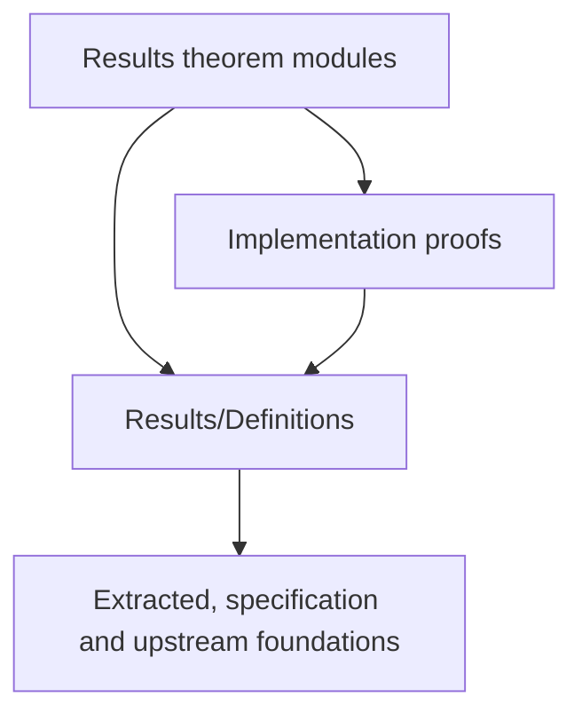

# Auditing the public guarantees

Results is the public reading surface. The theorem modules state the guarantees;
[Definitions](Definitions/README.md) supplies their complete handwritten vocabulary
in 19 semantic units. To understand a theorem, follow the definitions referenced
in its premises and conclusion, including certificate fields and constructors.
Implementation proof bodies are checked by Lean; they need not be read to determine what a statement means.

Definition modules are independent of implementation proofs. Theorem modules
import those proofs to establish the claims. Keeping the modules separate lets
implementation proofs use public vocabulary without importing the final theorems.
Import and semantic-closure checks enforce this distinction even though both
kinds of module live under Results.

Arrows below mean “may import.” A theorem's meaning follows the definitions;
its proof may use the implementation layer.



## Choose a guarantee

| Operation or subject | Statements | What to inspect |
| --- | --- | --- |
| Complete-module validation | [Validate](Validate.lean) | Normal return, accepted-module certificate, completeness limits and metadata correspondence. |
| Streaming validation | [Stream](Stream.lean) | Separate source/scheduler premises for soundness, normal return and completeness. |
| Issued code batches | [Batch](Batch.lean) | Worker reachability, entry validation, successful finish and batch-relative coordinates. |
| Operator callbacks | [Trace](Trace.lean) | Returning computations, callback order, immediates and the final rejecting callback. |
| Independent decoding | [Unique](Unique.lean) | Uniqueness from exact bytes without typing or implementation-limit premises. |
| Compilation | [Compile](Compile.lean) | Independent source/metadata correspondence, allocator law and source-only eligibility. |
| Store operations | [Store](Store.lean) | Issued identities/handles/values, decoded effects and preservation of the executable invariant. |
| Instantiation | [Instantiate](Instantiate.lean) | Linking, initialization, prepublication rollback, segment effects and the returned start handle. |
| Invocation | [Invoke](Invoke.lean) | Host/platform laws, actual event logs, evolving code, resource errors and divergence. |

`Main` joins these results and checked examples. Theorem modules do not import
one another, and implementation modules cannot import those theorem modules. This keeps each
claim independently discoverable rather than making publication depend on which
umbrella happens to import it. The exact registry is
[public-results.txt](../../scripts/public-results.txt).

## Read a Lean statement

```lean
theorem metadata.validate_module.sound
    (data : Slice U8) (decoded : metadata.Module)
    (accepted : metadata.validate_module data = .ok (.Ok decoded)) :
    Module.Sound.Validated data decoded
```

Parameters and premises precede the final colon; the conclusion follows it.
`(accepted : P)` names evidence of proposition `P`. A definition returning `Prop`
names a mathematical property rather than an executable Boolean check.

| Expression | Meaning |
| --- | --- |
| `.ok (.Ok decoded)` | The computation returns normally and Rust validation succeeds. |
| `.ok (.Err error)` | The computation returns normally and Rust validation rejects. |
| `∃ result, operation = .ok result` | The computation returns normally with either Rust outcome. |
| `operation ⦃ result => Property result ⦄` | Aeneas normal-return contract with a postcondition. |
| `RustResult.Post result (onSuccess := S) (onError := E)` | `S` holds for `.Ok`, or `E` for `.Err`; outer computation guarantees are separate. |
| `∀ x, P x`, `∃ x, P x` | Universal and existential quantification. |
| `P → Q`, `P ∧ Q`, `P ↔ Q` | Implication, conjunction and equivalence. |
| `{x : T}` | An implicit parameter inferred by Lean. |
| `data.val`, `index.val` | Underlying list of a slice, or mathematical integer value. |

Lowercase `.ok` belongs to the Aeneas computation model; uppercase `.Ok` and
`.Err` belong to Rust's `Result`. Normal return excludes modeled panic, overflow,
out-of-bounds access and divergence. Allocation and native wrappers retain their
explicit [trust boundary](../../../README.md#trust-boundary).

## Callback traces: one observation contract

[Trace](Trace.lean) states four guarantees: byte provenance for any returning
body run, agreement with typing for an accepted run, completeness for valid
bodies with accepting callbacks, and the function-start/body trace of an
accepted code entry. Each uses the same `Records visitor observe` premise:
every returning callback appends its event and reply to the observed log.
The events include the callback arguments and exposed state; the semantics
retain exact order and the final rejecting callback.

No particular logging implementation is required. The checked instrumentation
and recorder constructions remain in Visitor, with their convenience theorems
in Body/Trace/Acceptance. They are outside the public semantic reading surface.

## Validation: one shared witness

[Module.Sound.Validated](Definitions/Validation.lean) asserts the
existence of one raw module satisfying all of these conditions:

- The independent grammar relates the exact input bytes to that raw module.
- Elaboration translates it to SpecTec syntax with the required index and shape
  conditions.
- Returned environment and tail metadata describe the same raw module.
- The generated `Module_ok` judgment and additional language restrictions hold.
- Public import/export type accessors agree with its external types.

The shared witness matters: bytes, typing and metadata cannot choose unrelated
interpretations. [Unique](Unique.lean) separately proves at most one decoding.

Completeness starts from independently encoded bytes, elaboration, generated
typing, language restrictions and implementation limits. It assumes neither
parser success nor another validator's acceptance. Signature caps are separate
from language validity. Soundness and completeness therefore have different
premises; inspect the actual theorem rather than transferring assumptions
between them.

## Streaming: distinct embedding obligations

[Streaming](Definitions/Streaming.lean) separates coherent source views, callback
normal return, canonical region availability and scheduler behavior. Worker
provenance relates returned workers to issued batches through actual operations;
advancing a cursor alone cannot certify validation. Completeness uses a separate
queue contract: accept bounded submissions and return their actual `validate_all`
results in any order. The scheduler need not establish Wasm typing or successful
worker finishing; those follow inside the completeness proof. Outstanding workers and source
storage retain the documented Rust lifetime and ownership obligations.

Byte coordinates differ: entry offsets refer to the complete code region,
function starts refer to batch code, and operator positions refer to the
instruction body. Read those coordinates when assessing callbacks or adapters.

Whole-module validation uses the same streaming driver through a contiguous
source and synchronous worker. Its construction discharges the generic embedding
premises internally.

Streaming results return the validated tail with a `Stream.TailDelivery`
certificate. It describes the successful `tail_ready` call and subsequent worker
polls ending at the returned visitor state. Clients can use
`TailDelivery.preserves` to retain properties established by their tail callback;
the synchronous adapter uses it to identify its stored tail. Driver phase records
remain internal, while source coherence and worker provenance premises are unchanged.

## Execution: an abstract store protocol

Compilation supplies the independent typed source and matching public metadata.
Completeness additionally needs configured limits covering the computed source
budget and an allocator that grants its bounded requests. The budget retains
conservative estimates; callers do not supply preparation maxima or metadata
representations.
The compiled artifact's behavior follows through instantiation and invocation.

Start with `Integration.runtime_verified` in [Store](Store.lean), which proves
`∃ Inv, RuntimeContract view Inv`. Choose the predicate once. The contract groups read, mutation, instantiation and invocation capabilities
under this same predicate. Individual results require only their capability. Its
explicit laws establish it for a fresh store and preserve it through definitions,
mutations, instantiation and calls. Callbacks preserve this same predicate;
they can establish that obligation by composing the store API laws. The
predicate's private implementation is not part of the theorem premises.

Read [RuntimeContract and host laws](Definitions/Runtime.lean)
and [Platform](Definitions/Platform.lean) for the full obligations.
The runtime contract is proved to exist. Platform laws remain embedding premises;
native allocation, identity issuance, memory and floating-point wrappers are
not proved to satisfy them by these theorems.

A proof begins by obtaining the protocol once:

```lean
obtain ⟨Inv, api⟩ := Integration.runtime_verified view
have created := api.toStoreMutationContract.with_identity memory code id limits positive
```

Use that same `Inv` for callback laws and subsequent operations. The existential
witness is not a correctness assumption: `runtime_verified` constructs its laws
from the checked implementation proof. Argument rejection is stated through ownership and source typing. Resource
exhaustion and interruption retain reachable source effects; exact reservation
causes remain internal. The separate `resource_complete` law rules out resource
errors under conservative source budgets and embedding availability; see
[Resources](Definitions/Resources.lean).

Instantiation returns the start handle rather than executing it. A prepublication
rejection preserves the old store; segment traps preserve completed writes and
allocations. Invocation behavior relates actual returned outcomes and event logs
to source executions. The [invocation result table](Invoke.lean) distinguishes
success, input rejection, traps, exhaustion/interruption and divergence; link and
internal errors are excluded. All returned cases retain the store predicate and
existing code meanings and identities. Termination requires excluding both infinite source runs
and reachable diverging callbacks. One terminating source execution is insufficient.

## Follow the construction

After determining statement meaning, follow the short proof in its Results
module to its implementation owner. The [architecture map](../../README.md#proof-architecture)
and [runtime guide](../Runtime/README.md) explain construction dependencies.
Independent bytes, declarative typing and extracted computation remain separate
models throughout the argument. The [proof engineering guide](../../PROOF_ENGINEERING.md)
covers contracts, naming and editing practices.
