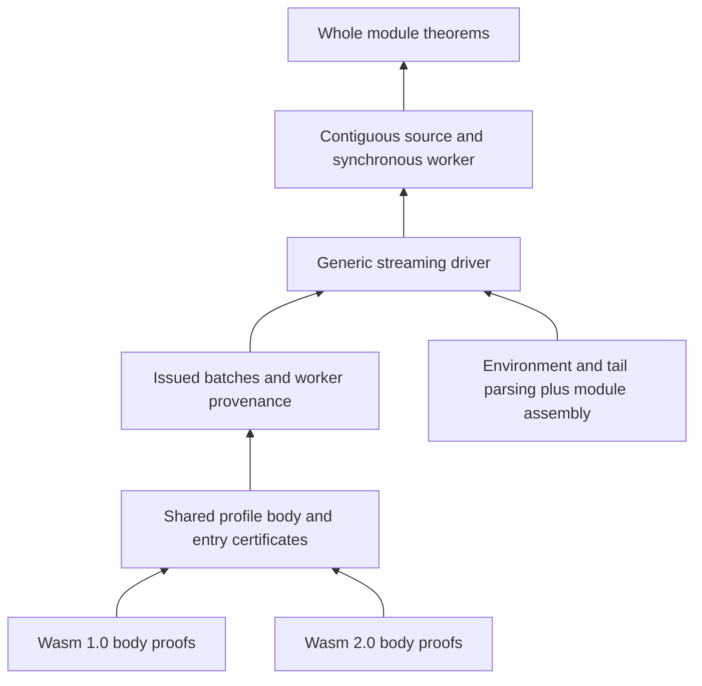

# A guide to the itasca proofs

itasca proves that its Rust validator terminates on every input, accepts only
valid modules, and accepts every valid module within its implementation limits,
for both Wasm 1.0 and Wasm 2.0. This guide starts at the public theorems and
works inward. It assumes you know Wasm but not Lean. For setup, commands, and the
directory layout, see the [Lean guide](README.md).

## The top-level theorems

[Main.lean](Itasca/Main.lean) lists every headline theorem, stated in full
under [Results/](Itasca/Results), and [Contracts.lean](Itasca/Contracts.lean)
defines the obligations the streaming results place on an embedding.
[Results/Validate.lean](Itasca/Results/Validate.lean) states the final
guarantees about `Itasca.metadata.validate_module`:

| Theorem | Guarantee |
| --- | --- |
| `profile_total` | For any bytes and either profile, validation returns an ordinary result (`Ok` or `Err`) without panic, overflow, out-of-bounds access, or divergence. |
| `profile_sound` | If validation returns `Ok decoded`, then `ModuleSound.Validated data decoded profile` holds. |
| `profile_spec` | `profile_total` and `profile_sound` together. |
| `profile_complete` | Independently encoded, well-typed modules within the limits are accepted, with matching returned metadata. |
| `profile_complete_with_metadata` | Also identifies the results of the import and export type accessors. |

`profile_*` theorems cover both `.Wasm1` and `.Wasm2`; the `wasm_*` variants
specialize to Wasm 1.0. Allocation failure is outside the model, and nothing
here says anything about Wasm execution or a compiler consuming the callbacks.

### The soundness certificate

[`ModuleSound.Validated`](Itasca/Module/Soundness.lean) says there is **one raw
module** such that:

| Component | Meaning |
| --- | --- |
| `ModuleEncodingWith (Profile.CodeEncoding profile)` | The input bytes encode that module, including section framing and complete consumption ([Binary/Module](Itasca/Binary/Module.lean)). |
| `Elaborates raw (moduleOf raw)` | The raw module translates to SpecTec syntax with valid type references and matching function/code counts ([Module/Elab/Elaboration](Itasca/Module/Elab/Elaboration.lean)). |
| `Matches decoded.env decoded.tail raw` | The returned declarations, data, and index-space caches describe that module ([Module/Elab/Metadata](Itasca/Module/Elab/Metadata.lean)). |
| `Module_ok (moduleOf raw)` | The module is valid under the generated SpecTec typing rules. |
| `ModuleElaboration.Profile raw profile` | Extra language conditions hold: export-name uniqueness, table/memory counts, profile-specific signatures and bodies, and `ref.func` declarations ([Module/Elab/Profile](Itasca/Module/Elab/Profile.lean)). |
| `AccessorTypes decoded.env raw` | `import_types` and `export_types` return this module's external types in order. |

Because every component talks about the same witness, the bytes, the typing
derivation, and the returned metadata cannot each pick a different reading of
the input.

### The completeness premises

```lean
(hb : ModuleEncodingWithinLimits raw data.val profile)
(hsignatures : ModuleSignaturesWithinLimits raw)
(he : Elaborates raw (moduleOf raw))
(ht : Module_ok (moduleOf raw))
(hp : Profile raw profile)
```

These describe bytes and declarative validity without mentioning itasca. There
is no premise that parsing succeeded or that bodies passed some other checker.
[Module/Limits.lean](Itasca/Module/Limits.lean) defines the byte and local
bounds; [Profile/Types.lean](Itasca/Profile/Types.lean) defines the signature
caps. The values are listed in the [implementation bounds](../src/limits.rs).

## Reading Lean

```lean
theorem metadata.validate_module.profile_sound
    (data : Slice U8) (decoded : metadata.Module)
    (profile : ValidationProfile)
    (h : metadata.validate_module data profile = .ok (.Ok decoded)) :
    ModuleSound.Validated data decoded profile
```

Everything before the last colon is a parameter or assumption; the rest is the
conclusion. `(h : P)` names a proof of `P`. A theorem is a function from proofs
of its assumptions to a proof of its conclusion. A definition returning `Prop`
names a property, not a Boolean check.

Two layers of results show up everywhere:

| Expression | Meaning |
| --- | --- |
| `.ok (.Ok decoded)` | The computation returns normally and Rust validation succeeds. |
| `.ok (.Err e)` | The computation returns normally and Rust validation rejects. |
| `∃ r, f = .ok r` | The computation returns normally with either outcome. |

Lowercase `.ok` is Aeneas's computation model; uppercase `.Ok`/`.Err` is Rust's
`Result`. Aeneas also writes `f ⦃ r => P r ⦄` for "`f` returns normally with an
`r` satisfying `P r`", so `f ⦃ _ => True ⦄` still asserts termination.

| Lean | Reading |
| --- | --- |
| `∀ x, P x`, `∃ x, P x` | For every `x`; there exists an `x`. |
| `P → Q`, `P ∧ Q`, `P ↔ Q` | Implies, and, iff. |
| `{x : T}` | Implicit parameter, inferred by Lean. |
| `⟨a, b⟩`, `h.1`, `h.field` | Build or project a tuple, structure, or proof. |
| `data.val`, `n.val` | Underlying list of a slice, or value of an integer. |
| `0x01#u8` | Aeneas typed integer literal. |
| `List.Forall₂ R xs ys` | Same length, and corresponding entries satisfy `R`. |

Wasm inference rules become constructors of inductive propositions:
`Instr_ok.nop` is the rule for `nop`, and `Instrs_ok.seq` composes two sequence
derivations. In [the generated specification](SpecTec/wasm2.0.lean), read
`Instr_ok C op ft` as `C ⊢ op : ft`. The `wf_*` premises are well-formedness
conditions, separate from typing.

Proofs after `:= by` are tactic scripts. On a first read, look at the statement
and at which earlier theorems the proof uses. `step` applies the specification
of an extracted computation's next operation; `scalar_tac` and `omega` handle
arithmetic.

## Three models

| Model | Source | Role |
| --- | --- | --- |
| Extracted program | Rust via Charon and Aeneas, in [Generated/Funs.lean](Itasca/Generated/Funs.lean) | The validator's actual control flow and state. |
| Binary grammar | Handwritten in [Binary/](Itasca/Binary) | Relates exact bytes to instruction trees and raw modules. |
| Declarative typing | SpecTec, in [SpecTec/wasm2.0.lean](SpecTec/wasm2.0.lean) | Judgments such as `Instr_ok`, `Func_ok`, and `Module_ok`. |

Aeneas models mutation by threading state, so a step usually returns a Rust
result together with updated state. Search an extracted function name in
`Funs.lean` to find its Rust source location.

The grammar is independent: its relations never mean "itasca accepted these
bytes". It allows nonminimal LEB128 and keeps raw float and vector bits.
`moduleOf` translates raw modules to SpecTec syntax, and `Elaborates` rules out
bad lookups hidden by that total function.

The profile fills in what generated typing does not say. Wasm 1.0 adds its
single-result and strict `br_table` restrictions. Both profiles add
export-name uniqueness and the `ref.func` declaration condition in
[Spec/DeclaredReferences](Itasca/Spec/DeclaredReferences.lean). The Wasm 2.0
instruction restriction is `True` because the binary grammar already bounds the
instruction set.

## From the API inward



`validate_module` runs the streaming driver with a private contiguous source and
synchronous worker. [Stream/SliceSound](Itasca/Stream/SliceSound.lean) and
[Stream/SliceComplete](Itasca/Stream/SliceComplete.lean) discharge the generic
streaming contracts for that adapter.

### Module assembly

A module splits into the environment before code, the code entries, and the
tail. [Module/Env/Basic](Itasca/Module/Env/Basic.lean) defines what the parser
proves about the environment: `Cache` (merged index spaces), `Valid` (semantic
checks), and `Bounded` (sizes for safe arithmetic). Callers never supply these.

[`Profile.Entry`](Itasca/Profile/CodeEntry.lean) ties one code entry's bytes to
its function type and body typing. `ModuleSound.assembled_regions` in
[Module/Soundness](Itasca/Module/Soundness.lean) combines environment, typed
entries, and tail into `Validated`. For completeness,
`StreamCompleteRegions.prepare` in
[Stream/DriverRegions](Itasca/Stream/DriverRegions.lean) derives the component
certificates from the independent premises.

### Streaming

The generic driver theorems are stated in
[Results/Stream](Itasca/Results/Stream.lean) and proved in
[DriverSound](Itasca/Stream/DriverSound.lean),
[DriverTotal](Itasca/Stream/DriverTotal.lean), and
[DriverComplete](Itasca/Stream/DriverComplete.lean). Each direction needs
different embedding contracts, defined in [Contracts](Itasca/Contracts.lean)
and summarized in the [Lean guide](README.md#streaming-premises).

The key worker definition is [`StreamBatch.Reachable`](Itasca/Contracts.lean):
a worker's history starts at an issued seed and grows only through actual
`next_entry` and `validate_func` executions. A worker cannot claim validation by
advancing a cursor. Workers may finish in any order.

## Body proofs: stacks versus trees

The validator mutates operand and control stacks; the typing rules describe
instruction trees. The body invariant connects them midway through a function.

[Wasm2/Invariant](Itasca/Wasm2/Invariant.lean) defines `Wasm2.State`, which
carries cursor and stack bounds, a partially rebuilt instruction tree (a
*zipper*, in [Wasm2/Frames](Itasca/Wasm2/Frames.lean)) related to the runtime
stacks, typing for processed instructions, and byte provenance for the consumed
prefix. These are proof witnesses, not runtime state. The state takes the
profile: under Wasm 1.0 it also carries Wasm 1.0 byte provenance and the
Wasm 1.0 restrictions for each open frame
([Wasm2/ProfileFrames](Itasca/Wasm2/ProfileFrames.lean)).

The invariant constrains only consumed bytes, so the rest of the body may be
malformed. `Pending` is the state after reading an opcode but before its
immediate. Each handler either returns an error or restores the invariant, which
gives soundness and termination on arbitrary input.

[Handler/Sequence](Itasca/Handler/Sequence.lean) handles stack polymorphism.
`Realizes` relates the validator's stack types, including `.Bot`, to declarative
stacks; `TypedPrefix` says the consumed instructions can produce every stack the
frame represents.

`Wasm2.steps` in [Wasm2/Soundness](Itasca/Wasm2/Soundness.lean) combines the
instruction cases, [Wasm2/SoundLoop](Itasca/Wasm2/SoundLoop.lean) lifts them
through the loop, and `State.finished` turns a closed state at the end of the
body into encoding and typing evidence.

Both profiles run the same Rust body reader. Wasm 1.0 adds filters before the
shared rules: opcodes outside the Wasm 1.0 grammar, block types other than the
empty and single-value ones, a non-zero `call_indirect` table byte, and
`br_table` targets of different types
([Wasm2/ProfileFilters](Itasca/Wasm2/ProfileFilters.lean)).
[Wasm2/ProfileAgreement](Itasca/Wasm2/ProfileAgreement.lean) shows a Wasm 1.0
run either matches the Wasm 2.0 run or stops at a filter.
[Profile/Body](Itasca/Profile/Body.lean) connects each profile to the common
contract in [Profile/BodySpec](Itasca/Profile/BodySpec.lean).

### Following `nop`

1. `code.step_nop.total` in [Visitor/Basic](Itasca/Visitor/Basic.lean): the
   extracted step returns with unchanged validator stacks whether the hook
   accepts or rejects.
2. `TypedPrefix.nop` in [Wasm2/Scalar/Prefix](Itasca/Wasm2/Scalar/Prefix.lean): append
   the `nop` typing rule to a typed prefix.
3. `Pending.step_nop` in [Wasm2/Scalar/Step](Itasca/Wasm2/Scalar/Step.lean):
   combine the step, the `0x01` encoding, and the typing to restore the
   invariant.
4. `steps` in [Wasm2/Soundness](Itasca/Wasm2/Soundness.lean): reach it through
   the scalar branch.

Every instruction follows this pattern: what the handler does, which bytes it
consumed, which typing rule applies, and how the invariant is restored.

### Completeness

Preserving an invariant does not show that valid input succeeds. Completeness
runs the other way: from independent encoding and typing, it constructs a
successful execution. `code.bodyCore.complete` in
[Wasm2/Completeness](Itasca/Wasm2/Completeness.lean) builds on `Program` in
[Wasm2/Complete/Program](Itasca/Wasm2/Complete/Program.lean), which recurses over
encoded instruction structure. [Spec/TypingInversion](Itasca/Spec/TypingInversion.lean)
unpacks derivations whose sequence, frame, and subtyping rules do not line up
with the validator's next step. The accepted bodies in
[Examples/Wasm2/Body](Itasca/Examples/Wasm2/Body.lean) apply the theorem to
concrete blocks, `if`s, loops, and branch tables.

## Callbacks and uniqueness

[Profile/BodyVisitor](Itasca/Profile/BodyVisitor.lean) relates visiting to plain
validation. `FullVisitor.Total` allows callback errors; `FullVisitor.Accepts`
requires callback success. The trace theorems (`trace_sound` and
`trace_complete` in [Results/Trace](Itasca/Results/Trace.lean), proved in
[Wasm2/Trace/Correspondence](Itasca/Wasm2/Trace/Correspondence.lean)) identify
callback order, state snapshots, and immediates, and show a rejecting callback
is the last one.

A trace proof and a typing proof may each produce an instruction tree for the
same bytes. [Results/Unique](Itasca/Results/Unique.lean) shows the bytes have
at most one decoding, so the trees agree.

## Where to start

1. Read [Main](Itasca/Main.lean) and the [Results/](Itasca/Results) files it
   lists. Start with `profile_sound` and `profile_complete` in
   [Results/Validate](Itasca/Results/Validate.lean), then unfold `Validated`.
2. Read `empty_accepted` and `empty_validated` in
   [Examples/Module/Basic](Itasca/Examples/Module/Basic.lean), and
   [Examples/Wasm2/Module](Itasca/Examples/Wasm2/Module.lean), where a
   multi-result module is accepted under Wasm 2.0 and rejected under Wasm 1.0.
3. Follow `nop`, then read `Wasm2.State` and `State.finished`.
4. Follow `Profile.Entry` into `ModuleSound.assembled_regions`, and the stream
   [Contracts](Itasca/Contracts.lean) if streaming interests you.
5. Then completeness and traces.
6. For execution, read the runtime results that [Main](Itasca/Main.lean) lists
   and the embedder obligations in
   [Runtime/Contracts](Itasca/Runtime/Contracts.lean). The
   [execution proof guide](Itasca/Runtime/README.md) explains how they are assembled.

## Names and proof units

Module paths describe dependency placement; namespaces describe the semantic
owner. A store decoder belongs to `Store` even when its module lives in
`Runtime/Representation`, below compiler, interpreter, and store constructions.
Runtime namespaces use `Compiler` for handwritten compiler concepts,
`SourceMachine` for the flat source model, `Interp.Machine` for machine proofs
and `Integration` for joined constructions. Extracted `Itasca.code`,
`Itasca.runtime.*`, SpecTec identifiers and third-party names retain their
original spelling.

| Kind | Convention | Example |
| --- | --- | --- |
| Module | `UpperCamelCase`, naming its subject without repeating its directory | `Store/Api/MemoryFill` |
| Type, structure, inductive, named predicate | `UpperCamelCase` | `ExecutableInv`, `FramePoint` |
| Computational definition | `lowerCamelCase` | `decodeStore` |
| Theorem basename | `snake_case`, describing its conclusion | `memory_fill_decodes`, `step_integer32_core_forward` |

Facts about extracted functions hang off their Rust path, such as
`metadata.validate_module.profile_sound` and `runtime.interp.invoke_with.behaves`.
Facts about a relation belong under that relation where practical. Wasm names
retain their instruction spelling, including `br_if` and `call_indirect`.
Suffixes such as `_eq`, `_iff`, `_sound`, `_complete`, and `_spec`, or a
`preserves_` prefix, are useful when they describe the conclusion; they are not
required endings. Public theorem names and statements remain stable during
internal cleanup.

Group the relation, supporting lemmas, and result that answer one proof question.
For memory fill, follow the handler effect through mutation to decoded source
semantics; for integer constants, follow instruction fetch through capacity and
step preservation to ownership. Keep a separately consumed contract below its
expensive constructions. A short module is appropriate when it owns such a
boundary. Begin each new or consolidated module with a docstring explaining its
question, main relation or result, and consumers; use section comments to mark
argument stages.

Qualifiers such as `Core`, `Supported`, `Cumulative`, `Eventful` and `Executable`
distinguish grammars, ownership, mutation or host-event premises. Their
[documented meanings](Itasca/Runtime/README.md#naming-and-extending-the-proofs)
remain part of the argument even when related proofs share a module. Avoid catch-all
module names such as `Misc`, `Extra`, or `Aux`; name a helper's responsibility
or place it with its consumers. The runtime guide gives the
[three API reading paths](Itasca/Runtime/README.md#reading-paths).

Check a module and its dependencies with `just check Itasca.Wasm2.Scalar.Step`.
