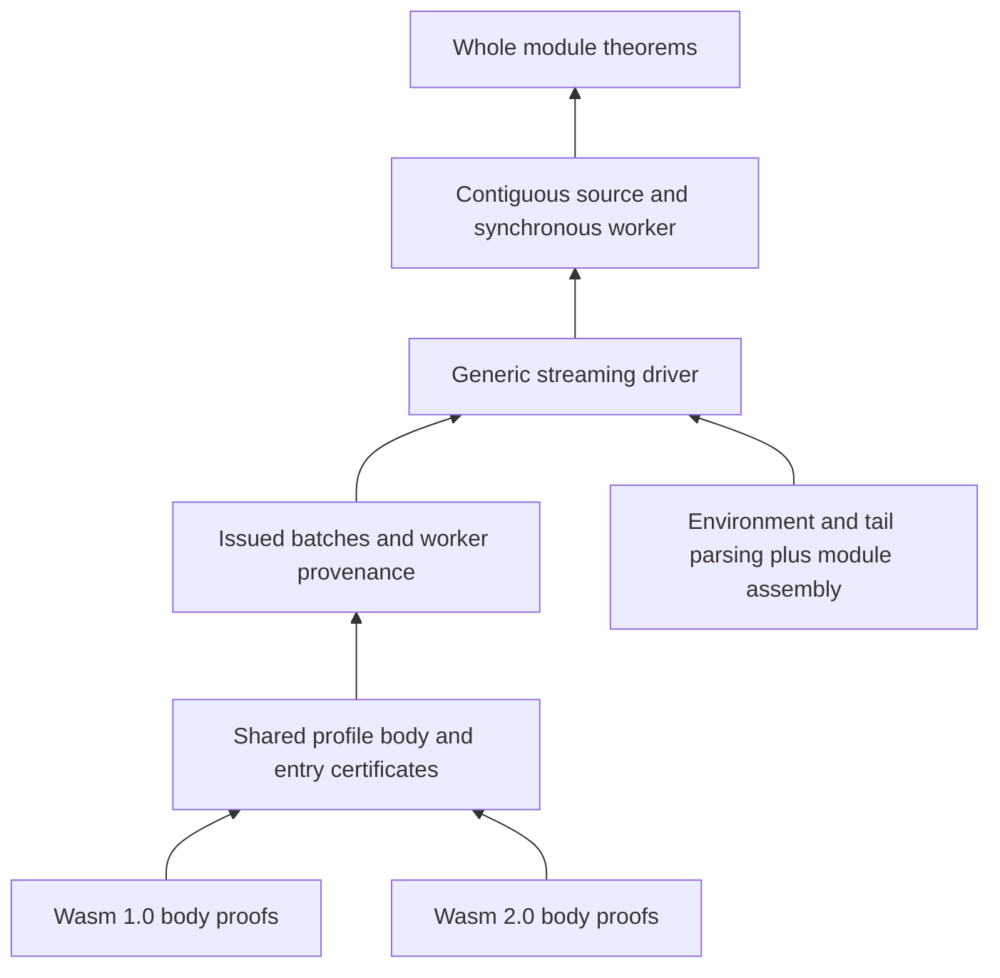

# A guide to the itasca proofs

itasca proves that its Rust validator terminates, accepts only valid modules,
and accepts every valid module within its implementation limits. The current
proofs cover both Wasm 1.0 and Core 2.0. This guide starts at the public API and
works inward to the invariants that connect a streaming validator to Wasm's
declarative typing rules. It assumes familiarity with Wasm, but no prior Lean
experience.

## Start with the whole module theorems

Open [ModuleValidation.lean](Itasca/Module/ModuleValidation.lean) and
[ModuleCompleteness.lean](Itasca/Module/ModuleCompleteness.lean). These are short:
their job is to expose the final guarantees after the supporting layers have
done the work. The names below are inside the `Itasca` namespace, so their fully
qualified names begin with `Itasca.module.validate_module`.

| Theorem suffix | What it guarantees |
| --- | --- |
| `profile_total` | For any input bytes and either profile, validation returns an ordinary Rust result. It does not panic or diverge in the extracted model. Invalid input may return `Err`. |
| `profile_sound` | If validation returns `Ok decoded`, the input and returned metadata satisfy `ModuleSound.Validated data decoded profile`. |
| `profile_spec` | Packages termination and soundness together: the function returns normally, and every successful result has that certificate. It places no further condition on ordinary errors. |
| `profile_complete` | Independently encoded, elaborated, well-typed modules satisfying the selected profile and implementation limits are accepted. The returned declarations and data match the given module. |
| `profile_complete_with_metadata` | Also identifies successful results of the public import and export type accessors for that same module. |

Here, “termination” includes absence of modeled arithmetic overflow and
out-of-bounds access. Allocation failure is outside the model. These are
validation guarantees; they do not establish Wasm execution or correctness of
a compiler consuming the callbacks.

The `profile_*` statements quantify over `.Wasm1` and `.Wasm2`. The adjacent
`wasm_*` whole-module theorems specialize them to Wasm 1.0. Some lower-level
names also contain `wasm`, so check the function and premises rather than
inferring the profile from that word alone.

### What the soundness certificate contains

The definition to follow from `profile_sound` is
[`ModuleSound.Validated`](Itasca/Module/ModuleSoundness.lean). It says that
there exists **one raw module** for which all of the following hold:

| Part of the certificate | Meaning and definition |
| --- | --- |
| `ModuleBinary.ModuleEncodingWith (Profile.CodeEncoding profile)` | The complete input bytes encode that module under the chosen profile. Section framing, instruction bytes, and complete consumption are accounted for. See [ModuleBinary.lean](Itasca/Binary/ModuleBinary.lean) and [CodeEntry.lean](Itasca/Profile/CodeEntry.lean). |
| `Elaborates raw (moduleOf raw)` | The raw binary representation translates to the generated specification's module syntax with valid type references and equal function/code counts. See [ModuleElaboration.lean](Itasca/Module/ModuleElaboration.lean). |
| `Matches decoded.env decoded.tail raw` | Returned declarations, data segments, and merged index-space caches describe that raw module. See [ModuleMetadata.lean](Itasca/Module/ModuleMetadata.lean). |
| `Module_ok (moduleOf raw)` | The elaborated module has a derivation in the generated SpecTec typing rules. See [wasm2.0.lean](SpecTec/wasm2.0.lean), declaration `Module_ok`. |
| `ModuleElaboration.Profile raw profile` | Additional language conditions hold, including export-name uniqueness, table/memory counts, profile-specific signatures and bodies, and reference declarations. See [ModuleProfile.lean](Itasca/Module/ModuleProfile.lean). |
| `AccessorTypes decoded.env raw` | `import_types` and `export_types` return the external types of this module in declaration order. See [ModuleMetadata.lean](Itasca/Module/ModuleMetadata.lean). |

The shared existential witness matters. The theorem connects the bytes,
typing derivation, and actual returned metadata to the same module; each
component cannot choose a different interpretation of the input.

### What completeness assumes

Read the argument list of `profile_complete` as the admission criteria:

```lean
(hb : ModuleEncodingWithinLimits raw data.val profile)
(hsignatures : ModuleSignaturesWithinLimits raw profile)
(he : Elaborates raw (moduleOf raw))
(ht : Module_ok (moduleOf raw))
(hp : Profile raw profile)
```

These describe bytes and declarative validity independently of running itasca.
There is no premise saying that parsing succeeded or that the function bodies
already passed an executable checker. The conclusion supplies that success.

[ModuleLimits.lean](Itasca/Module/ModuleLimits.lean) adds resource bounds to the
independent encoding: total module bytes, instruction-body bytes, and flattened
declared locals. Body size includes the final `end` and excludes local
declarations; the local count excludes parameters. Signature caps are a
separate predicate, defined through [Profile/Types.lean](Itasca/Profile/Types.lean).
They cap Wasm 2.0 parameter and result counts while retaining Wasm 1.0's existing
parameter behavior. The current values are in [src/limits.rs](../src/limits.rs)
and the [public limits table](../README.md#implementation-limits).

Soundness and completeness are separate directions. Soundness rules out false
acceptances; completeness rules out false rejections under these premises.
Totality rules out a third outcome in the model: failing to return an ordinary
result at all.

## Reading a Lean theorem

Here is the actual shape of `profile_sound`, omitting its proof:

```lean
theorem module.validate_module.profile_sound
    (data : Slice U8) (decoded : module.Module)
    (profile : ValidationProfile)
    (h : module.validate_module data profile = .ok (.Ok decoded)) :
    ModuleSound.Validated data decoded profile
```

Everything before the last colon is an input or assumption. The expression
after it is the conclusion. `(h : P)` means “a proof of proposition `P`, named
`h`.” A theorem is a function that takes its parameters and evidence for its
assumptions and produces evidence for its conclusion. `Prop` is Lean's type of
propositions; a definition returning `Prop` names a property, rather than a
Boolean checker.

The two success constructors belong to different layers:

| Expression | Meaning |
| --- | --- |
| `.ok (.Ok decoded)` | The extracted computation returns normally, and Rust validation succeeds. |
| `.ok (.Err e)` | The extracted computation returns normally, and Rust validation rejects. |
| `∃ r, f = .ok r` | There is an ordinary returned result; it can be either Rust outcome. |

Lowercase `.ok` belongs to Aeneas's computation model. Uppercase `.Ok` and
`.Err` model Rust's `Result`. This is why `profile_total` does not promise that
arbitrary bytes are valid.

You will also see `f ⦃ r => P r ⦄`. This Aeneas specification notation says
that `f` returns normally with a result `r` satisfying `P r`.
`WP.spec_imp_exists` turns it into `∃ r, f = .ok r ∧ P r`. In particular,
`f ⦃ _ => True ⦄` still asserts normal termination. The postcondition `True`
places no restriction on the returned value.

Some other notation is useful immediately:

| Lean | How to read it |
| --- | --- |
| `∀ x, P x`, `∃ x, P x` | For every `x`; there exists an `x`. |
| `P → Q`, `P ∧ Q`, `P ↔ Q` | Implication, conjunction, equivalence. |
| `{x : T}` | An implicit parameter Lean normally infers from context. |
| `⟨a, b, ...⟩` | Build a tuple, a structure, or evidence for a conjunction/existential. |
| `h.1`, `h.2`, `h.field` | Extract a component or named field. |
| `data.val`, `n.val` | The underlying list of a modeled slice/vector, or mathematical value of a modeled integer. |
| `0#usize`, `0x01#u8` | Aeneas typed integer literals. |
| `List.Forall₂ R xs ys` | The lists have equal length and corresponding entries satisfy `R`, in order. |

A `structure ... : Prop where` bundles named proof obligations. For example,
`Elaborates` has fields for type-index bounds and code counts. An `inductive`
proposition specifies ways to construct evidence. Wasm inference rules become
constructors of inductive propositions: `Instr_ok.nop` is the rule for `nop`,
and `Instrs_ok.seq` composes two instruction-list typing derivations.

In [the generated specification](SpecTec/wasm2.0.lean), read
`Instr_ok C op ft` as `C ⊢ op : ft`, `Instrs_ok C ops ft` as the corresponding
sequence judgment, and `Module_ok m` as module validity. Generated wrappers
such as `.mk_functype (.mk_list []) (.mk_list [.I32])` mean the familiar
function type `[] → [i32]`. The accompanying `wf_*` premises describe
well-formed specification objects; they are distinct from typing derivations.

Proofs after `:= by` use tactics to construct evidence checked by Lean's
kernel. On a first pass, read the statement, then notice which earlier
theorems the proof calls. You can defer most tactic details:

| Tactic | Purpose |
| --- | --- |
| `intro`, `exact`, `apply` | Introduce an assumption, supply a proof, or reduce the goal to another theorem's premises. |
| `constructor`, `refine ⟨..., ?_⟩` | Build a structured conclusion, leaving subgoals for missing pieces. |
| `obtain ⟨...⟩ := h`, `rcases h` | Unpack evidence into witnesses and facts. |
| `cases`, `induction` | Split by constructors, or prove recursively with induction hypotheses. |
| `rw`, `simp`, `simpa` | Rewrite equalities and simplify; `simpa using h` adapts an existing proof by simplification. |
| `rfl` | Prove equality by unfolding definitions and computation. |
| `omega`, `scalar_tac` | Discharge arithmetic obligations; `scalar_tac` handles Aeneas scalar machinery. |
| `step` | Apply specifications to an extracted computation's next operation. |

## The models being connected

There are three main representations. Keeping them distinct helps explain why
so many adapters and correspondence lemmas exist.

| Representation | Where it comes from | Role |
| --- | --- | --- |
| Extracted program | Rust through Charon and Aeneas into [Generated/Types.lean](Itasca/Generated/Types.lean) and [Generated/Funs.lean](Itasca/Generated/Funs.lean) | Models the actual validator's control flow, state updates, checks, and returns. |
| Independent binary syntax | Handwritten [Binary/](Itasca/Binary) and [MultiValue/Binary.lean](Itasca/MultiValue/Binary.lean) | Relates exact bytes to tokens, structured instructions, and raw module declarations. |
| Declarative syntax and typing | SpecTec generates [SpecTec/wasm2.0.lean](SpecTec/wasm2.0.lean) | Supplies Wasm 2.0 judgments such as `Instr_ok`, `Instrs_ok`, `Func_ok`, and `Module_ok`. |

Aeneas represents mutations by passing state explicitly and returning updated
state in tuples. This is why a callback or instruction step often returns both
a Rust result and new validator or visitor state. When connecting a proof to
Rust, search the extracted function name in `Funs.lean`; its generated comments
identify the Rust source location. The main implementation counterparts are
[src/code.rs](../src/code.rs), [src/module.rs](../src/module.rs), and
[src/stream.rs](../src/stream.rs).

The handwritten grammar is independent in a specific sense: its validity
relations do not mean “itasca accepted these bytes.” For example,
[`Wasm.Immediate`](Itasca/Binary/WasmBinary.lean) gives literal opcodes and
their encodings, while `Wasm.BodyEncoding` connects the entire body, including
its closing `end`, to a structured instruction list. The module grammar handles
section framing, order, names, locals, and segments. It permits valid nonminimal
LEB encodings and tracks raw float/vector bits.

`moduleOf` then elaborates raw declarations into SpecTec syntax. The separate
`Elaborates` predicate ensures that total helper definitions do not hide bad
lookups or truncate mismatched function/code lists. This translation is about
Wasm representations; it is unrelated to Lean's own use of “elaboration” for
processing source code.

The explicit profile completes the language contract. Wasm 1.0 needs its
single-result restrictions and stricter `br_table` target equality even when
the generated Wasm 2.0 typing relation permits more. For both profiles, module
conditions supplement gaps such as export-name uniqueness. The independent
[DeclaredReferences.lean](Itasca/Profile/DeclaredReferences.lean) condition
supplies the missing reference-declaration requirement for `ref.func` in the
pinned generated typing model.

For Wasm 2.0, `Profile.Instructions` is `True`; this does not admit arbitrary
future instructions. The independent Wasm 2.0 binary grammar still bounds the
instruction set. See [Profile/Instructions.lean](Itasca/Profile/Instructions.lean)
and [WasmCompletenessBoundary.lean](Itasca/Examples/WasmCompletenessBoundary.lean)
for the Wasm 1.0 branch-table distinction.

## Follow the composition from the public API inward

This diagram shows how the major contracts combine, rather than every import:



The public `validate_module` uses the streaming pipeline with a private
contiguous source and synchronous worker. That explains why
`ModuleValidation.lean` delegates directly to `stream.validate_module_slice`
theorems. [StreamSlice.lean](Itasca/Stream/StreamSlice.lean) discharges the
generic contracts for this adapter and proves that its returned `Module`
contains the decoded environment and delivered tail.
[StreamSliceCompleteness.lean](Itasca/Stream/StreamSliceCompleteness.lean)
does the same for completeness.

### Module parsing and assembly

The module proof separates the environment before code, code entries, and the
tail. In [ModuleEnv.lean](Itasca/Module/ModuleEnv.lean), `Cache` records that
merged runtime index spaces correspond to imports followed by definitions;
`Valid` records semantic checks; `Bounded` accounts for sizes needed by safe
allocation and cursor arithmetic. The environment parser proves these facts
about its actual output. They are not assumptions that a public caller must
manufacture.

Each code entry adds its size prefix and grouped locals to a body certificate.
[`Profile.Entry`](Itasca/Profile/CodeEntry.lean) connects the entry's exact byte
interval to the appropriate function-section type index and generated body
typing. The soundness and completeness bridges are in
[EntrySound.lean](Itasca/Profile/EntrySound.lean) and
[EntryComplete.lean](Itasca/Profile/EntryComplete.lean).
[ModuleDecomposed.lean](Itasca/Module/ModuleDecomposed.lean) explains how an
accepted environment supplies the prerequisites of these component validators.

[ModuleSoundness.lean](Itasca/Module/ModuleSoundness.lean), especially
`ModuleSound.assembled_regions`, combines environment, ordered typed entries,
and tail evidence into `Validated`. Its byte equation requires the three
regions to concatenate to the complete input. They need not share an allocation.
The semantic side uses [ModuleAssembly.lean](Itasca/Module/ModuleAssembly.lean)
and related translation lemmas to build generated module typing; the byte side
uses [ModuleComposition.lean](Itasca/Module/ModuleComposition.lean).

On the completeness side,
[StreamCompleteRegions.lean](Itasca/Stream/StreamCompleteRegions.lean),
declaration `prepare`, derives component certificates from the independent
module premises. Section and entry completeness then produce successful
executions, which the driver proof composes. This is where the top-level
“no parser-success premise” promise becomes concrete.

### Streaming and parallel workers

The generic driver theorems are `stream.validate_streaming.profile_sound` in
[StreamValidation.lean](Itasca/Stream/StreamValidation.lean), `profile_total`
in [StreamDriverTotal.lean](Itasca/Stream/StreamDriverTotal.lean), and
`profile_complete` in [StreamDriverComplete.lean](Itasca/Stream/StreamDriverComplete.lean).
Their assumptions differ for good reasons:

| Claim | Embedding contract |
| --- | --- |
| Soundness | `StreamSource.Coherent` says successful views agree with fixed logical bytes. `StreamScheduler.Provenance` says returned workers arise from issued workers through real batch operations. The initial scheduler state must track an empty issued history for this invocation. |
| Termination | Source and scheduler `CallbacksTotal` contracts require normal callback returns. Valid bytes, coherent views, provenance, and successful workers are unnecessary. |
| Completeness | `StreamSource.CanonicalAvailable` supplies successful reads of the canonical regions. `StreamAcceptingScheduler.Accepts` supplies an accepting policy with positive batch settings, preserved queues, and actual worker validation, starting with an empty queue for this invocation. |

Read the contract definitions in
[StreamSource.lean](Itasca/Stream/StreamSource.lean),
[StreamScheduler.lean](Itasca/Stream/StreamScheduler.lean), and
[StreamAcceptingScheduler.lean](Itasca/Stream/StreamAcceptingScheduler.lean).
Soundness permits source errors and does not require a canonical split.
Completeness needs stronger availability and acceptance assumptions because a
source or callback can otherwise reject valid bytes.

The central worker definition is
[`StreamBatch.Reachable`](Itasca/Stream/StreamBatch.lean). Its constructors
start from an issued seed and extend the history with actual `next_entry` or
`validate_func` executions. A worker cannot acquire validation evidence merely
by claiming that its cursor advanced. Dispatch and validation cursors are
separate; framing an entry does not validate it. Successful retirement combines
this history with the driver's identity and finish checks to establish ordered
function coverage and exact byte coverage.

Workers can complete in any order under these contracts. The proofs do not
verify an operating-system scheduler, network progress, or an embedding's
memory safety. The generic soundness witness identifies the tail actually
delivered to `tail_ready`; it does not assume arbitrary visitor state stores
that tail. The contiguous adapter proves the stronger returned-`Module` fact.

## How a body proof connects stacks to instruction trees

The validator consumes bytes and mutates operand/control stacks. The typing
rules describe structured instruction trees. The body invariant connects
these two views while validation is partway through a function.

Start with [WasmInvariant.lean](Itasca/Body/WasmInvariant.lean), especially
`Wasm.State`, `Wasm.Pending`, and `State.finished`. A running state carries:

1. Bounds on the cursor and stacks.
2. A representation of the current frame and its saved parents, related to
   the actual runtime control and operand stacks.
3. Typing evidence for the instructions processed inside those frames.
4. Exact byte provenance for the consumed prefix.

The saved frames in [WasmFrames.lean](Itasca/Body/WasmFrames.lean) form a
partially reconstructed instruction tree: the current body plus the surrounding
blocks, loops, and pending arms. This is sometimes called a *zipper*. These
trees and typing derivations are proof witnesses, not extra runtime state.

Crucially, the invariant constrains only consumed bytes. The unread suffix may
be malformed. `Pending` represents the point where an opcode has been read
but its immediate has not been validated. An instruction handler must either
return an ordinary error or preserve the invariant and advance appropriately.
This supports soundness and termination on arbitrary input, without assuming
the rest of the body is valid.

[Sequence.lean](Itasca/Body/Sequence.lean) explains stack polymorphism.
`Realizes` relates the validator's concrete stack types and `.Bot` entries to
declarative stacks. An unreachable frame can represent an arbitrary stack
prefix beneath its explicit operands. `TypedPrefix` says the consumed
instructions can produce every stack represented by the frame. Its lemmas
compose generated typing rules as validation progresses.

[WasmStep.lean](Itasca/Body/WasmStep.lean), theorem `Wasm.steps`, combines the
instruction cases. [WasmBody.lean](Itasca/Body/WasmBody.lean) lifts step
contracts through the loop. When frames are closed and the cursor is exactly
at the end, `State.finished` yields complete encoding and typing evidence.
[WasmSoundness.lean](Itasca/Body/WasmSoundness.lean) exposes the body theorems;
[Wasm1Soundness.lean](Itasca/Body/Wasm1Soundness.lean) adds the explicit
Wasm 1.0 profile.

The directory [MultiValue/](Itasca/MultiValue) contains the full Wasm 2.0 body
development, despite its narrower historical name. Its
[Invariant.lean](Itasca/MultiValue/Invariant.lean) follows the same consumed
prefix approach, with indexed signatures, multi-value frames, and reference
declaration evidence. The principal results are in
[BodyTotal.lean](Itasca/MultiValue/BodyTotal.lean),
[Soundness.lean](Itasca/MultiValue/Soundness.lean), and
[Complete.lean](Itasca/MultiValue/Complete.lean); supporting families cover
references, bulk memory, scalar extensions, and SIMD.

Both profiles use the shared Rust body loop.
[SharedLoop.lean](Itasca/Body/SharedLoop.lean) proves equality with the
proof-only [LegacyExecution.lean](Itasca/Body/LegacyExecution.lean) model used
by the Wasm 1.0 development. That model is connected to the extracted program
by a proof. [Profile/BodySpec.lean](Itasca/Profile/BodySpec.lean) defines the
common independent body contract, while
[Profile/Body.lean](Itasca/Profile/Body.lean) connects each profile's validator
to it. The module and streaming layers can consequently share their proofs.

### A small proof to read in full

Follow `nop` through these four locations:

1. [Nop.lean](Itasca/Body/Nop.lean), `code.step_nop`: an accepting callback
   makes the extracted step succeed with unchanged validator stacks. The visitor
   may update its own state. The adjacent rejection theorem handles its error.
2. [Sequence.lean](Itasca/Body/Sequence.lean), `TypedPrefix.nop`: append the
   generated `nop` typing rule to an already typed prefix, preserving its stack.
3. [WasmStepScalar.lean](Itasca/Body/WasmStepScalar.lean), `Pending.step_nop`:
   combine the runtime step, byte `0x01` encoding, and prefix typing to preserve
   the full invariant.
4. [WasmStep.lean](Itasca/Body/WasmStep.lean), `steps`: use that result in the
   `OP_NOP` dispatcher branch.

This small case shows the recurring division of work: establish what the
extracted handler does, identify the consumed bytes, apply a declarative typing
rule, and restore the surrounding invariant. Calls, memory operations, and
structured control add lookup and frame obligations to this pattern.

### Why completeness needs a separate development

Preserving an invariant on successful steps does not prove that a well-typed
input will succeed. Completeness starts from independent encoding and typing
and constructs a successful execution.

[WasmComplete.lean](Itasca/Body/WasmComplete.lean) exposes
`code.validate_body.wasm_complete`. Follow `Completeness.programs` into
[CompletenessProgram.lean](Itasca/Body/CompletenessProgram.lean), where
`Program` states that a typed encoded instruction list executes successfully
from a suitable frame. The proof recurses through encoded instruction
structure and smaller nested bodies.
[DeclarativeComplete.lean](Itasca/Body/DeclarativeComplete.lean) handles the
fact that generated typing derivations can contain sequence, framing, and
subtyping rules in forms that do not directly match the validator's next step.
The Wasm 2.0 development has corresponding completeness layers.

For a concrete use, read `nested_body` and `nested_accepted` in
[CompletenessExamples.lean](Itasca/Examples/CompletenessExamples.lean).
The example constructs encoding and typing for a nested block/if, then invokes
the general completeness theorem to obtain acceptance.

## Callbacks and decoding uniqueness

Visitors add another observable behavior to validation. The shared
[Profile/BodyVisitor.lean](Itasca/Profile/BodyVisitor.lean) separates three
useful facts: accepted visiting executions erase to non-visiting acceptance;
accepting visitors lift non-visiting success; returning visitors support
termination. `FullVisitor.Total` permits ordinary callback errors, whereas
`FullVisitor.Accepts` requires callback success.

The detailed operator trace development is for Wasm 1.0.
[VisitorBodyTrace.lean](Itasca/Visitor/VisitorBodyTrace.lean) proves
`code.validate_body_with.trace_sound` and `trace_complete` under the stated
recording and acceptance contracts. These connect callback order, state
snapshots, and immediates to the encoded body.
[ModuleEntryTrace.lean](Itasca/Module/ModuleEntryTrace.lean) adds the
function-start event and entry bounds.
[VisitorTraceCorollaries.lean](Itasca/Visitor/VisitorTraceCorollaries.lean)
proves that an observed rejecting callback is included and is last.

These statements concern ordinary returned executions and do not assert
compiler IR correctness or a complete trace specification for every rejected
whole-module run.

Independent decoding uniqueness is useful here: a trace proof and a typing
proof may each produce an instruction-tree witness for the same bytes.
Uniqueness lets them identify those witnesses. See
[WasmBinaryUnique.lean](Itasca/Binary/WasmBinaryUnique.lean) and
[Profile/BinaryUnique.lean](Itasca/Profile/BinaryUnique.lean). These results
require neither typing nor implementation-size bounds. They say that fixed
bytes have at most one decoding under a profile; nonminimal LEBs mean that a
value can still have several valid encodings.

## Trust and a practical reading route

Lean's kernel checks proof terms, including terms generated by tactics. That
establishes the formal statements about the models. Relating those models to
the running Rust library still relies on faithful Charon/Aeneas extraction,
SpecTec generation, the handwritten grammar and translations, and the runtime
toolchain. Aeneas's library and loop models are also part of this boundary.
[FunsExternal.lean](Itasca/Generated/FunsExternal.lean) is handwritten and
models `Vec.pop` and `Vec.is_empty`; allocation capacity and failure are absent.
The full boundary and recorded specification discrepancies are documented in
the [project README](../README.md#trust-boundary) and
[Lean guide](README.md#expanding-the-supported-profile).

[Audit.lean](Itasca/Audit.lean) checks transitive axiom dependencies of every
declaration from imported local modules, including helpers and proof-bearing
definitions. Only `propext`, `Classical.choice`, and `Quot.sound`, the documented
standard logical foundations, are allowed. The
[audit coverage script](scripts/check_audit.py) ensures that all local proof
modules are reachable. This prevents a proof from silently depending on an
unfinished lemma or a project-specific assumption; it does not prove that the
chosen specification matches the intended external standard.

A useful first reading session is:

1. Read `profile_sound` and `profile_complete`, then unfold `Validated` and
   its six components. This establishes the destination of the proof chain.
2. Read `empty_accepted` and `empty_validated` in
   [ModuleExamples.lean](Itasca/Examples/ModuleExamples.lean). For both profiles,
   [MultiValueModule.lean](Itasca/Examples/MultiValueModule.lean) proves a
   multi-result module accepted under Wasm 2.0 and rejected under Wasm 1.0.
3. Follow the `nop` path above, then read `Wasm.State` and `State.finished`.
   This reveals the main body proof technique without first reading every opcode.
4. Follow `Profile.Entry` into `ModuleSound.assembled_regions`, then read the
   source and scheduler contracts if streaming is your area of interest.
5. Return to completeness and the trace proofs once the certificates and
   invariant are familiar.

Most declarations are under `Itasca`, but file paths and namespaces are not
identical. For example, `Itasca/Body/WasmInvariant.lean` defines `Itasca.Wasm.State`.
Root files such as [Itasca/ModuleValidation.lean](Itasca/ModuleValidation.lean)
are stable import wrappers; follow their imports to the implementation files.
Search by declaration name or use your editor's go-to-definition command.

After the [setup instructions](README.md#setup), run checks from the repository
root:

```sh
just check Itasca.Body.Nop
just check Itasca.Examples.CompletenessExamples
just prove
```

The targeted commands check those modules and their dependencies. `just prove`
builds the integrated development and checks audit coverage and axioms.
`just trust` reruns the detailed axiom report. Preserve build caches, put scratch
files in `$TMPDIR`, and never hand-edit generated program or specification files.
If you begin changing proofs, follow the
[development workflow](../DEVELOPMENT.md#build-and-verification).
